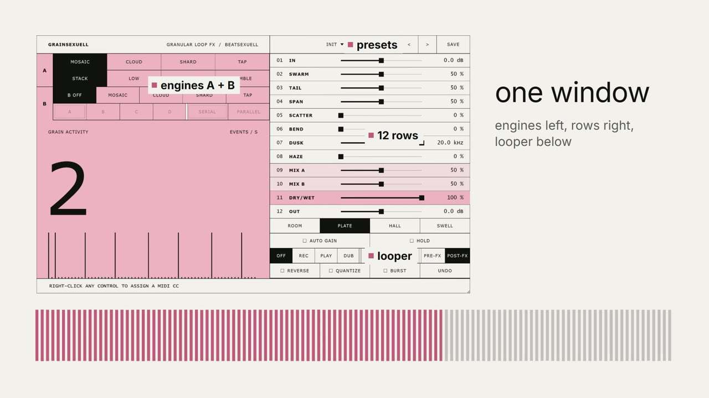

# grainsexuell

[English](README.md) · [Deutsch](README.de.md) · **Español** · [Français](README.fr.md) · [日本語](README.ja.md)

Un multiefecto granular de micro-loops con dos motores y un looper de frases, creado por **beatsexuell**.
VST3 para Windows, macOS y Linux, AU para macOS, LV2 para Linux, y una aplicación standalone.

> Escucha lo que acabas de tocar y lo recuerda mal.

[](https://youtu.be/63asHO567NA)

▶ [Ver el tutorial (3 min)](https://youtu.be/63asHO567NA)

## Funciones

- **Cuatro motores, cuatro variantes cada uno**
  - **Mosaic**: captura el último momento como micro-loop y lo apila a 0,5x / 1x / 2x / 4x
  - **Cloud**: nube granular, de 3 a 80 granos por segundo
  - **Shard**: troceador glitch sincronizado al tempo (shuffle, crush, arp, stutter)
  - **Tap**: delay multitap (echo, ping-pong, reverse, cascade)
- **Dos ranuras**: motor A y un motor B opcional, en **serie** (A y luego B) o en **paralelo** (A y B mezclados)
- **Controles macro**: Swarm (densidad), Tail (repeticiones), Span (longitud), Scatter (aleatoriedad), Bend (oscilación de tono)
- Filtro paso bajo **Dusk**, reverb **Haze** (Room / Plate / Hall / Swell), Mix A y Mix B por motor, un **Dry/Wet** maestro, ganancia de entrada y salida (±24 dB)
- **Hold**: congela el último pulso y lo repite dentro del efecto
- **Looper de frases**: Off / Rec / Play / Dub, velocidad ½ · 1x · 2x, antes o después del efecto, reverse, quantize, burst, undo
- **Auto Gain**: mantiene la salida cerca del nivel de entrada, con un techo de seguridad
- **56 presets de fábrica** en seis categorías (Ambient, Shimmer, Rhythmic, Echo, Lo-Fi, Drift), además de los tuyos
- **MIDI learn**: clic derecho sobre cualquier control y mueve una perilla de tu controlador
- **Sincronía de tempo**: Tap y Shard siguen el tempo del host
- Ventana redimensionable, indicador de actividad granular en vivo y aviso cuando hay una nueva versión

## Instalación

Descarga la última versión en [Releases](https://github.com/Beatsex/grainsexuell/releases).

| Sistema | Cómo |
|---|---|
| Windows 10 / 11 (64 bits) | Ejecuta `grainsexuell-…-win64-setup.exe`. La beta aún no está firmada: si aparece SmartScreen, haz clic en *Más información* → *Ejecutar de todas formas*. |
| macOS | Copia `grainsexuell.vst3` en `~/Library/Audio/Plug-Ins/VST3` y `grainsexuell.component` en `~/Library/Audio/Plug-Ins/Components`. Consulta `INSTALL_mac.txt`. |
| Linux | Copia la carpeta VST3 / LV2 en `~/.vst3` / `~/.lv2`. Consulta `INSTALL_linux.txt`. |

Después reinicia tu DAW (o vuelve a escanear los plugins) e insértalo como efecto de audio: *beatsexuell → grainsexuell*.

## Inicio rápido

1. Pon grainsexuell en una pista con algo melódico o rítmico.
2. Haz clic en **>** junto al nombre del preset para recorrerlos, o en el nombre para abrir las categorías.
3. Gira **Swarm** para más o menos eventos y **Tail** para repeticiones más largas o más cortas.
4. Activa el motor **B** y elige **Serial** o **Parallel** para texturas en capas.
5. Pulsa **Hold** para congelar un momento, o pon el looper en **Rec** para grabar una frase.

El manual completo (`USER_MANUAL.html`, en inglés) viene con cada descarga.

## Compilar desde el código

Requisitos: CMake 3.22+, un compilador C++20 (Visual Studio 2022, Xcode o GCC/Clang). JUCE 8 y Catch2 se descargan automáticamente.

```
cmake -B build -G "Visual Studio 17 2022" -A x64   # o: cmake -B build -DCMAKE_BUILD_TYPE=Release
cmake --build build --config Release -j
ctest --test-dir build -C Release --output-on-failure
```

El plugin queda en `build/grainsexuell_artefacts/Release/`.

## Comentarios

Abre un [issue](https://github.com/Beatsex/grainsexuell/issues) con el preset o los ajustes, lo que tocaste, lo que escuchaste, tu DAW y la frecuencia de muestreo. Si se cuelga: qué DAW y qué fue lo último en lo que hiciste clic.

## Licencia

[MIT](LICENSE) © beatsexuell
